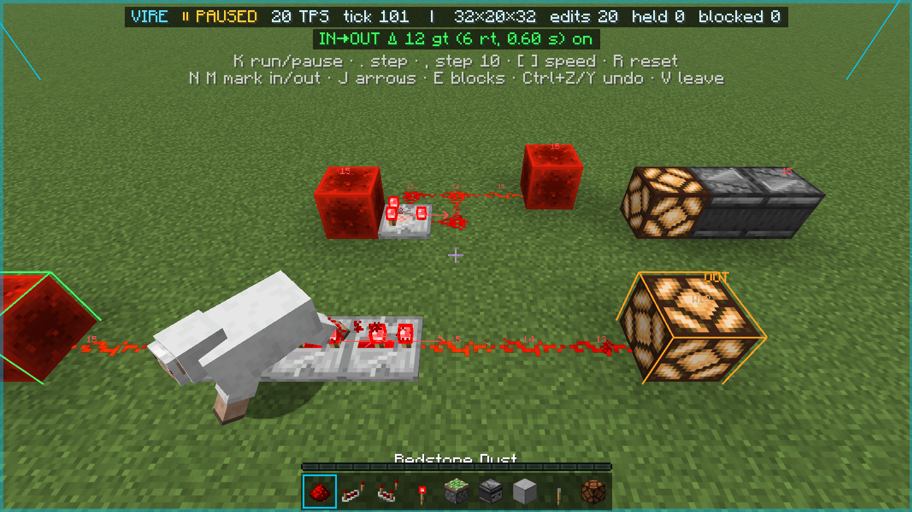
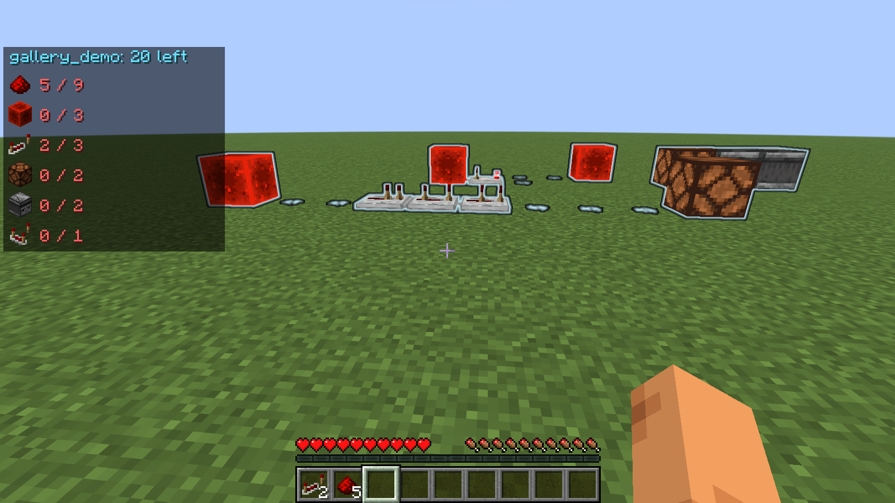

<p align="center"></p>

# Vire

A client-side redstone sandbox for Minecraft 26.3 (Fabric).

Press **V** in survival, on any server, to enter **Vire Mode**: a private copy of the area around you.
Fly a free camera, place and break any block, and run the circuit with exact vanilla redstone. You can
pause it, step it one game tick at a time and change its speed. Nothing you do there reaches the server.
When you leave, your design becomes a see-through ghost to build from, with the materials you still
need, or a `.litematic` file for Litematica.



> **Your body stays in the real world.** While you are in Vire Mode your player stands still where you
> pressed V. Taking damage, dying, being moved by the server or changing dimension ends Vire Mode at
> once (your design is saved as `_autosave`). Enter only where your body is safe. Some servers do not
> allow freecam-style mods; Vire does not hide itself, so check the server's rules.

## What it does

- **Exact vanilla redstone.** The copy runs in a small private Minecraft server inside your client, so
  repeaters, comparators, observers, pistons (block events, quasi-connectivity), falling blocks, TNT and
  items behave exactly as in the real game. A test kit compares it tick by tick with a real server.
- **Time control.** Starts paused. Run or pause, step 1 or 10 game ticks, 1 to 100 ticks per second.
- **Signal overlay.** Power levels on dust, outputs of repeaters, comparators, observers and other
  components, `S`/`W` on strongly or weakly powered blocks, and arrows showing where things output.
- **Delay meter.** Mark an input and an output: Vire shows the delay in game ticks, redstone ticks and
  seconds (`Δ 12 gt (6 rt, 0.60 s)`), and for a clock its period, frequency and on time.
- **Undo, redo, reset.** Every change can be undone; reset rebuilds the circuit from your design.
- **Ghost and materials.** After leaving, keep the design as a ghost in the real world: missing blocks
  show see-through, a block in the way gets a red box, the right block in the wrong state a yellow box
  with what is expected (`facing: west expected`). A panel lists the materials still needed against
  your inventory. Built blocks disappear; a toast says when the design is complete.
- **Litematica export.** Save the design as `.litematic`; with Litematica installed it is loaded and
  placed at its real position at once.



## Keys

| Key | Action |
|---|---|
| `V` | Enter / leave Vire Mode |
| WASD, Space, Shift, Ctrl | Fly the camera (Ctrl = faster) |
| Right / left click | Place / break (hold to repeat) |
| Middle click | Pick block into the virtual hotbar |
| `E` | Block palette (click = selected slot, hover + 1–9 = that slot) |
| Ctrl+Z / Ctrl+Y | Undo / redo (rebuilds the circuit, paused) |
| `K` | Run / pause the circuit (starts paused) |
| `.` / `,` | Step 1 / 10 game ticks |
| `[` / `]` | Slower / faster (1–100 TPS) |
| `R` | Reset the circuit to your design |
| `N` / `M` | Mark the block you look at as delay input / output (again = unmark) |
| `J` | Flow arrows on / off |
| `B` | Materials panel on / off (when a ghost is shown) |

All keys can be changed in Controls → Vire.

## Leaving Vire Mode

When you leave with changes, a dialog asks for a name:

- **Keep as ghost**: show the design in the real world to build from.
- **Save only**: store it in `config/vire/designs/<name>.json`.
- **Export .litematic**: write `schematics/vire/<name>.litematic` (and place it in Litematica when
  it is installed).
- **Discard**: drop it. Escape keeps it as `_autosave`.

A design shows only on the server and in the dimension where you made it.

## Commands

| Command | Action |
|---|---|
| `/vire` | Enter / leave Vire Mode |
| `/vire size <16..64>` | Region size for the next time you enter (default 32) |
| `/vire ghost <name>` / `/vire ghost off` | Show a saved design as ghost / hide it |
| `/vire designs` | List the saved designs |
| `/vire bom` | Materials for the ghost, in chat |
| `/vire export <name>` | Export a saved design as `.litematic` |
| `/vire status` | Sandbox state, tick, memory |

## Good to know

- The private server starts in the background when you join a world (about 10 s, ~30 MB), so V is
  instant. Turn `keepWarm` off in `config/vire/config.json` to start it only when you press V.
- The copy only knows what your client knows: container contents you have not opened and some block
  entity data are not there.
- The region is a 32-block cube around you by default (16–64 with `/vire size`).
- Everything Vire writes lives in `config/vire/`; `.litematic` exports go to `schematics/vire/` so
  Litematica finds them.
- Litematica Printer 3.2.3 can print only part of an exported design: in our test it placed pistons
  and stairs, placed an observer the wrong way and skipped repeaters, comparators and hoppers.
  Litematica itself reads every block back exactly.

## Development

Needs Java 25.

```bash
./gradlew build
```

Self-tests run against the local test server (`./gradlew runServer`, `VireTester` must be op):

```bash
./gradlew runClient -Pselftest=quit --args="--username VireTester --quickPlayMultiplayer 127.0.0.1:25565"
```

Modes: `quit` (main acceptance test), `kit` (sandbox vs real server, tick by tick), `probe` (delay
meter), `ghost` (design → ghost → build it by hand in survival), `cycles` (leak check), `spike`
(sandbox boot cost), `shots` (gallery screenshots, add `--width 1600 --height 900`), and with
`-Plitematica` also `litematic` (export → Litematica; needs the Litematica, MaLiLib and Litematica
Printer jars from Modrinth in `libs/`). `-Ppacketlog` logs every packet sent while Vire Mode is on.
See [PLAN.md](PLAN.md) for the design and [CHANGELOG.md](CHANGELOG.md) for changes.

## License

MIT
